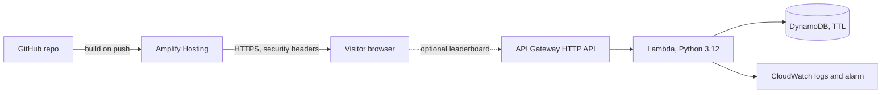

# Audit Me

A portfolio for **Abdul Hayee**, a cloud and DevOps engineer in Lahore, built for the
[AWS Student Builder Challenge: Build Your Tech Superpower](https://builder.aws.com).

The page loads as a normal, fast portfolio (About, Skills, Projects, Contact). One red button,
**Audit my infrastructure**, opens a simulated cloud console with real misconfigurations to fix.
Every correct fix explains why it works and declassifies a row of the "case file" on the page itself.

- **Live site:** _add your Amplify URL here after the first deploy_
- **Write-up:** _add the Builder Center project link here_

## The creative feature

| Finding | Correct fix | What it unlocks |
| --- | --- | --- |
| Public S3 bucket | Block Public Access and default encryption | Secure DevSecOps pipeline |
| Admin role used by a small API | Least-privilege policy | Snack Out results |
| SSH open to the internet | Close port 22, use Session Manager | Kubernetes microservices |
| Bonus: no audit logging | Multi-region CloudTrail with log validation | Superpower and a fun fact |

- Wrong picks show a hint that teaches the reason (and cost 25 points). Faster audits earn a time bonus.
- The clock only runs while a finding is on screen. Esc closes the console and progress is kept.
- The game is a **simulation**. It never touches real resources, and it needs no network.
- The portfolio never depends on it: all content is plain HTML, and the navigation works with the game closed.

## Architecture



Layer 1 (the site and game) runs entirely on **AWS Amplify Hosting**. Layer 2 (the leaderboard) is
optional: if the API is down or not configured, the game works the same and the leaderboard says it is offline.

| AWS service | Role |
| --- | --- |
| Amplify Hosting | Builds from GitHub on every push, serves the site over HTTPS, applies security headers |
| API Gateway (HTTP API) | `POST /score` and `GET /leaderboard`, throttled to 5 requests per second (burst 10), CORS limited to the site |
| Lambda | Validates every request and reads or writes the table. Reserved concurrency 5, 128 MB |
| DynamoDB (on demand) | Leaderboard entries, expire after 60 days with TTL |
| CloudWatch | Function logs (14-day retention) and an alarm on errors |
| AWS Budgets | 5 USD monthly cost guard with alerts at 50, 80 and 100 percent |
| IAM | One function role that can only `PutItem` and `Query` the one table |

## Repository layout

```
site/                 the static site Amplify serves
  index.html          all portfolio content (plain HTML)
  css/styles.css
  js/scenarios.js     all game text: edit wording, hints and unlock cards here
  js/engine.js        pure game logic (unit tested)
  js/ui.js            game UI (native <dialog>, no innerHTML)
  js/config.js        set apiUrl here to turn the leaderboard on
  assets/             diagrams, favicon, social preview image
  fonts/              self-hosted Archivo and JetBrains Mono (open licences included)
infra/
  template.yaml       SAM: API, Lambda, DynamoDB, alarm
  budget.yaml         monthly budget alerts
  lambda/app.py       leaderboard function
amplify.yml           Amplify build (runs the site checks first)
customHttp.yml        security headers, including the Content Security Policy
scripts/              site checks, local server, diagram and image generators
tests/                engine tests, Lambda tests, browser end-to-end test
docs/                 write-up kit and problem log
```

## Run it locally

No install needed for the site itself:

```bash
node scripts/serve.js 8080      # serves site/ with the same headers Amplify will send
# open http://localhost:8080
```

Or open `site/index.html` directly: it works from disk too.

## Test it

```bash
node scripts/check-site.js                     # sections, hint, CSP-safe markup, links, game content
node --test tests/engine.test.js               # game logic
python3 -m unittest discover -s tests -p "test_*.py"   # leaderboard Lambda
pip install cfn-lint && cfn-lint infra/*.yaml  # CloudFormation lint

# full browser test: plays the game on desktop and a 360 px phone, plus leaderboard and storage cases
npm i -D playwright && npx playwright install chromium
node scripts/serve.js 8080 &
node tests/e2e.js http://localhost:8080 ./out  # screenshots land in ./out
```

## Deploy

### 1. Set the cost guard first

```bash
aws cloudformation deploy --template-file infra/budget.yaml \
  --stack-name audit-me-budget --parameter-overrides AlertEmail=you@example.com
```

### 2. Host the site on Amplify (Layer 1)

1. Push this repository to GitHub (public).
2. In the AWS console open **AWS Amplify**, choose **Host web app**, connect GitHub, and pick this repository and the `main` branch.
3. Amplify reads `amplify.yml` (it serves the `site/` folder) and `customHttp.yml` (security headers) from the repository root. Save and deploy.
4. When the build finishes, open the URL. Check the headers:
   `curl -I https://YOUR-APP.amplifyapp.com | grep -iE "content-security|strict-transport|x-frame"`

### 3. Turn on the leaderboard (Layer 2, optional)

```bash
cd infra
sam build
sam deploy --guided --parameter-overrides AllowedOrigin=https://YOUR-APP.amplifyapp.com AlertEmail=you@example.com
```

Copy the `ApiUrl` output into `site/js/config.js` as `apiUrl`, make sure the region in
`customHttp.yml` (`connect-src`) matches the region you deployed to, then commit and push.
To switch the leaderboard off, set `apiUrl` back to `''` and push.

## Security and privacy decisions

- Strict Content Security Policy (no inline scripts or styles), HSTS, no framing, no third-party requests.
- Game and leaderboard text is written to the page as plain text, never as HTML.
- The leaderboard stores only a nickname, score and time. No IP address, no account, no cookies, no analytics.
- The browser computes the score, so the server only bounds it to what the game can produce. The leaderboard is a fun extra, not proof of anything.
- `check-site` runs in CI and in the Amplify build, so a broken page cannot go live.
- Secret scanning runs in CI. No credentials are stored in this repository.

## Measured results

Lighthouse (mobile, local run on the production headers): Performance 95, Accessibility 100,
Best Practices 100, SEO 100. Largest contentful paint 1.0 s, layout shift 0, 208 KiB transferred.
Re-run against the live URL before submitting.

## Credits

- Fonts: [Archivo](https://github.com/Omnibus-Type/Archivo) and [JetBrains Mono](https://github.com/JetBrains/JetBrainsMono), both under the SIL Open Font License (see `site/fonts`).
- Diagrams and the social preview image are generated by scripts in `scripts/`.
- All text, code and design were written for this project.
